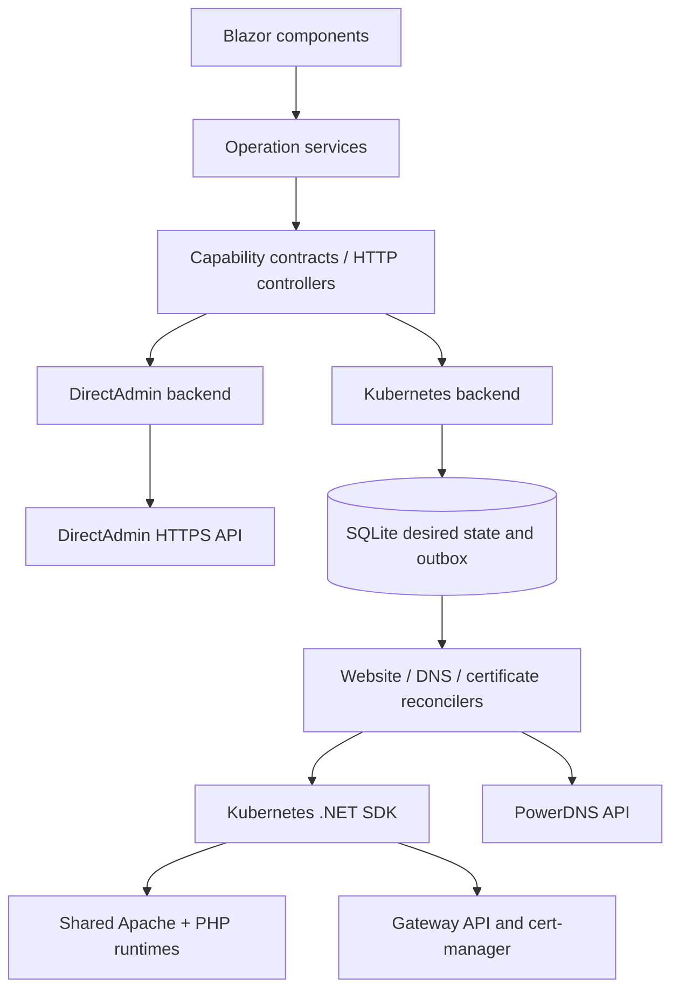

# Current architecture

HostingPanel is a single .NET 10 ASP.NET Core application (HostingPanel.Web), hosting Blazor Server/MudBlazor, HTTP controllers, authentication/session handling and composition. The selected backend is registered once in Program.cs using HostingPanel:Backend (DirectAdmin or Kubernetes).

Some UI operations still use a same-host HTTP client (hosting-api) through the operation services; this is transitional, not a separately deployed API application. CompatibilityApiClient is for explicit compatibility routes, not a generic backend interface.

| Assembly | Ownership |
| --- | --- |
| HostingPanel.Web | UI, controllers, authentication session, DI |
| HostingPanel.Backends.Abstractions | Independent capability interfaces, DTOs, public settings schema |
| HostingPanel.Backends.DirectAdmin | HTTPS transport, legacy adapters, backend services |
| HostingPanel.Backends.Kubernetes | Account authorization, desired-state services, reconciliation |
| HostingPanel.Persistence | Common EF Core model, SQLite initialization, extension contracts |
| HostingPanel.Providers.PowerDNS | Authoritative DNS API integration |
| HostingPanel.Providers.CertManager | Certificate integration and shared KubernetesResourceClient |

Controllers depend on individual capabilities (IAccountCatalog, IAccountMutations, IDNSProvider, IWebHosting, etc.). DirectAdminBackend is a provider-internal facade, not the universal application contract. Existing CLR namespaces may reflect earlier organization; assembly boundaries determine ownership.

## API and authorization

The pinned official DirectAdmin Swagger lives at src/HostingPanel.Web/spec/directadmin.swagger.json and is served by /openapi/directadmin.json. /api routes follow that contract and are forwarded where appropriate. HostingPanel-specific operations use /hosting. Forwarding is not proof of backend support. DirectAdmin receives caller credentials over a fixed HTTPS origin; Kubernetes authenticates locally and applies its own account visibility and mutation rules. Neither controller nor UI is a substitute for backend authorization.

The browser uses cookie authentication and a server-side panel session. The application validates session state and supplies effective credentials to operations. A UI action is not proof of resource permission.

## Desired and observed state

Kubernetes services persist desired resources and reconciliation operations. WebsiteReconciler manages website ConfigMaps/routes, shared PHP resources and cleanup; DnsReconciler handles deferred zone staging and PowerDNS publication; CertificateReconciler and ListenerSetReconciler manage certificate intent and TLS listener integration. Reconciliation is asynchronous. A 202 response means accepted intent, not operational availability.

The shared Apache service receives per-domain configuration; do not create Apache workloads per domain. KubernetesResourceClient uses the .NET SDK. PowerDNS publication and cert-manager issuance require their actual infrastructure and configuration.

See [configuration](configuration.md), [DNS](dns.md), [capabilities](capabilities.md) and [Kubernetes hosting](kubernetes-hosting.md).
